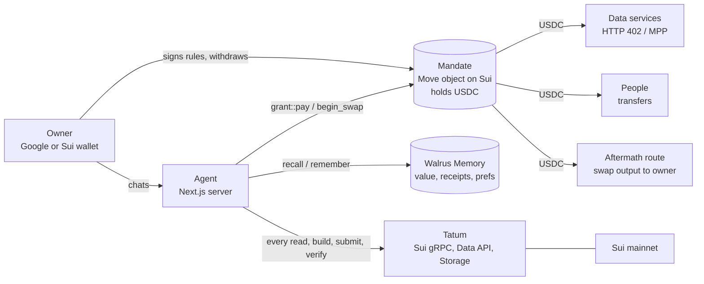

# MANDATE

**A prepaid card for AI agents.** You set the rules once. Your agent pays for information, sends
money and swaps coins inside them, learns which purchases are worth it, and every cent gets a
public receipt. Live on Sui mainnet, built on **Tatum** and **Walrus Memory**.

[](https://github.com/da-b0s/mandate/actions/workflows/ci.yml)

-6c5ce7)


**[Live app](https://mandate-gules-five.vercel.app)** ·
**[Demo video](https://youtu.be/jqGgQjtLf-E)** ·
**[Blog post](https://dev.to/dab0s/giving-an-ai-agent-a-wallet-it-cant-empty-10ei)** ·
**[Explorer](https://mandate-gules-five.vercel.app/explorer)** ·
**[Proof](docs/PROOF.md)** ·
[Architecture](docs/ARCHITECTURE.md) ·
[Tatum](docs/TATUM.md) ·
[Walrus Memory](docs/WALRUS_MEMORY.md) ·
[Threat model](docs/THREAT_MODEL.md) ·
[Limitations](docs/LIMITATIONS.md)

Total Recall: Tatum x Walrus Memory hackathon · Track 02, Smart Agents for Real Life

---

## The numbers

| | |
| --- | --- |
| **-86%** wasted spend | Same 50 tasks on mainnet, memory off vs on. Wasted spend fell from 1.25 to 0.18 USDC. |
| **-43%** cost per useful answer | 0.05 USDC down to 0.03 USDC, with 48 of 50 tasks still answered usefully. |
| **226** real payments | Real USDC on Sui mainnet, 7.35 USDC moved, every one linked in [PROOF.md](docs/PROOF.md). |
| **226 of 226** verified via Tatum | Every payment is re-read through Tatum's Sui gRPC before it counts. |
| **622** memories on Walrus | Ratings, receipts, spend records, approvals and preferences, in 33 namespaces. |
| **Limits checked onchain** | By the Move contract, inside the same transaction that moves the money. An over-limit payment aborts and nothing moves. |
| **36 + 33** tests | 36 Move unit tests for the contract, 33 for the policy engine, all in CI. |

## Why

AI agents can now do real jobs, and real jobs cost money: a data feed here, a payment to a person
there. Handing an agent your card is a bad idea. It can overspend, get tricked, or keep paying for
rubbish. Three things are missing:

1. **Bounds** the agent cannot argue its way past.
2. **A memory of value**, so it stops paying for sources that never help.
3. **Receipts** anyone can check.

MANDATE provides all three.

## What it does

- **Hard limits, enforced onchain.** Your USDC sits inside a *mandate*, a Move object on Sui. Every
  payment, transfer and swap goes through the contract, which checks the weekly allowance, the
  maximum per payment, per-service caps, the end date, revocation and an auto-freeze if you stop
  checking in. If a payment breaks a rule, the transaction aborts and nothing moves.
- **Buys information.** The agent pays data services per request over HTTP 402 (MPP on Sui), from
  the mandate, after checking the live price quote.
- **Sends money.** One-off or recurring: *"send 5 USDC to 0x... every week"*.
- **Swaps coins.** *"Swap 1 USDC to SUI every Friday"*: best route via Aftermath, the coins go
  straight to the owner's wallet, and the swap counts against the limits.
- **Learns what is worth paying for.** After a task you rate each paid source. Ratings are stored in
  Walrus Memory, one namespace per service and task type, and the agent skips sources whose
  pessimistic usefulness falls too low. It can also suggest tighter caps, which only take effect when
  the owner signs.
- **Leaves a receipt for every cent.** Each task gets a receipt linking every payment digest,
  verified independently through Tatum, with the full report archived on Walrus.
- **Your money back, any time.** The owner can withdraw everything, even after stopping the
  mandate. The agent cannot withdraw.

## Try it in 60 seconds

1. Open **[mandate-gules-five.vercel.app](https://mandate-gules-five.vercel.app)** and press
   **Get your agent**.
2. **Sign in with Google.** No crypto wallet is needed: zkLogin turns your Google sign-in into a Sui
   address that only you control. Your agent is created automatically.
3. **Set its rules.** The defaults are fine. Press **Sign my rules**; gas is sponsored.
4. **Money.** The first users get a welcome credit paid straight into their mandate. Otherwise, send a
   little USDC on Sui to the agent address shown.
5. **Chat.** Try *"Who holds token 0xA0b8...eB48? Any sanctioned holders?"*, *"Swap 0.05 USDC to
   SUI"*, or *"Is wallet 0x098B...2f96 safe?"* (answered by a free check, nothing spent).

No sign-in? The **[Explorer](https://mandate-gules-five.vercel.app/explorer)** shows every real
payment, the contract and the learning result, all linked to Suiscan and Walrus.

## How it works



A purchase, step by step:

1. The agent classifies the request and runs a **free Tatum security check** first. A sanctioned
   address needs no paid report.
2. It **recalls value memories** from Walrus for each candidate service and drops the ones that have
   not been worth it.
3. The vendor answers with an **HTTP 402 quote**. The agent reads the mandate **through Tatum** and
   checks the quote against every limit.
4. It submits **one transaction** in which `grant::pay` re-checks every limit and moves the USDC from
   the mandate to the vendor. Over a limit, the transaction aborts.
5. It **verifies the payment through Tatum** (sender, payee, amount), gets the data, writes the answer,
   and stores the receipt and spend in Walrus Memory.
6. You rate the purchase; the rating becomes a new versioned value memory for next time.

More in [ARCHITECTURE.md](docs/ARCHITECTURE.md).

## Built on Tatum

Tatum is on the critical path, not on a status badge. MANDATE runs on **Tatum's paid plan** (Starter:
4M credits a month, 200 requests per second) and its **Sui mainnet gRPC gateway** is the app's only
connection to the chain:

- **Every chain read** (mandates, balances, vault, events) goes through Tatum gRPC.
- **Every transaction** is built (gas price, dry run), submitted and confirmed through Tatum: payments,
  transfers, swaps, deposits, withdrawals and every owner action.
- **Every payment is verified** by re-reading it through Tatum before it counts: 226 of 226.
- **Two data services are built on the Tatum Data API** (token profiles, holders) and the **Tatum
  security API** screens addresses, including the free first check.
- **Full task reports are archived on Walrus through Tatum's Storage API.**
- **zkLogin sign-in** reads the current epoch and verifies signatures through Tatum.

Details and code pointers: [docs/TATUM.md](docs/TATUM.md).

## Built on Walrus Memory

The agent's memory *is* Walrus Memory, through the official `@mysten-incubation/memwal` SDK and
relayer. Nothing is reimplemented.

- **Value memory**: every rating becomes a versioned memory per (service, task type), in its own
  namespace so recall stays precise. The agent recalls these before every purchase.
- **Receipts and spend**: every task and payment, with digests and human-readable amounts.
- **Preferences**: free text from the owner goes through Walrus Memory's `analyze()` and comes back
  as facts the agent checks before paying ("never pay more than 0.03 for a single call").
- **Policy**: every cap the owner approves is remembered with its Sui transaction digest.
- **Per-user isolation**: each signed-in user's agent gets its own namespace prefix.
- **Portable**: the same memory answers questions in Claude Code through the official Walrus Memory
  MCP server ([docs/claude-code.md](docs/claude-code.md)).

Details: [docs/WALRUS_MEMORY.md](docs/WALRUS_MEMORY.md).

## The contract

`mandate::grant` ([on Suiscan](https://suiscan.xyz/mainnet/object/0x5065412934bf6d7e344656972694e5f0c84a5c02c05472787076f4bdc72b9993))

| Rule | Enforced by |
| --- | --- |
| Weekly allowance, rolling 7 days | `apply_spend`, inside `pay`, `begin_swap`, `record_spend` |
| Maximum per payment, per-service caps (a cap of 0 blocks a service) | `cap_for` |
| End date | `EExpired` |
| Revoke (permanent) | `revoke`, `ERevoked` |
| Auto-freeze if the owner stops checking in (dead man's switch) | `heartbeat`, `EDormant` |
| USDC only in the vault | `assert_usdc` |
| Only the agent can spend; only the owner can withdraw, change caps or revoke | `ENotAgent`, `ENotOwner` |
| Swap output always goes to the owner | `SwapTicket` (no abilities) consumed by `finish_swap` |

## Security, honestly

Agent keys are held by our server, encrypted at rest. Because the money lives in the mandate and the
contract checks every spend, a leaked agent key can lose at most what the limits allow, and the owner
can stop the mandate and withdraw at any time. The full picture, including what the Walrus relayer
can see, is in [THREAT_MODEL.md](docs/THREAT_MODEL.md) and [LIMITATIONS.md](docs/LIMITATIONS.md).

## Repository

```
apps/web        Next.js app: homepage, chat, settings, explorer; API routes; zkLogin; scheduler
apps/agent      task loop, MPP payments, transfers, swaps, custody, Walrus Memory, receipts
apps/vendors    three MPP-paid data services (HTTP 402), two built on the Tatum Data API
packages/move   mandate::grant, the Move contract (36 tests)
packages/policy pure TypeScript rules: limits, value model, proposals, preferences (33 tests)
packages/chain  Tatum gRPC client, grant transactions, execution, zkLogin, Tatum Data API
packages/store  Postgres (Neon): receipts, settings, agents, schedules
scripts         replay, verify, proof page, upgrade, demos
docs            proof, architecture, Tatum, Walrus Memory, threat model, limitations, replay data
```

## Run it locally

```bash
pnpm install
cp .env.example .env   # fill in the keys listed there
pnpm --filter @mandate/web dev
```

```bash
pnpm --filter @mandate/policy test        # 33 policy tests
sui move test --path packages/move        # 36 Move tests
pnpm verify                               # re-checks the claims in this README against mainnet
node scripts/proof-md.js                  # regenerates docs/PROOF.md from the live record
```

## Stack

Sui Move · Tatum (Sui gRPC gateway, Data API, Storage API) · Walrus Memory (`@mysten-incubation/memwal`)
· MPP on Sui (`@suimpp/mpp`, `mppx`) · Aftermath router · zkLogin (Shinami prover) · Gemini 2.5 Flash
for phrasing answers (it never decides spending) · Next.js · Neon Postgres · Render + Vercel
