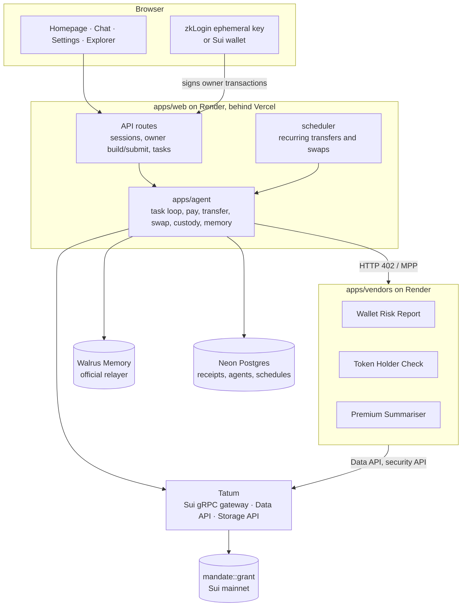

# Architecture

MANDATE is a pnpm monorepo: one web app, one agent library, one vendor service, a Move package and
three shared packages. Everything talks to Sui mainnet through Tatum.

## Packages

| Package | Role |
| --- | --- |
| `packages/move` | `mandate::grant`: the mandate object, limits, vault, `pay`, `begin_swap`/`finish_swap`, `withdraw`, heartbeat, revoke. 36 unit tests. |
| `packages/policy` | Pure TypeScript, no I/O: grant checks (mirror of the contract for clear messages), the Beta value model, cap proposals, preference rules. 33 vitest tests. |
| `packages/chain` | The Tatum gRPC client (with retry), grant BCS parsing and transaction builders, `execute()` with per-wallet lanes and gas sponsorship, zkLogin helpers, the Tatum Data API client. |
| `packages/store` | Postgres: receipts, MPP digest store, settings, per-user agents (keys encrypted with AES-256-GCM), schedules, welcome-credit claims. |
| `apps/agent` | The agent: classify, free check, recall, decide, pay, verify, answer, remember. Also transfers, swaps, custody sweeps, credits, receipts, proof data. |
| `apps/vendors` | Three MPP-paid HTTP services that charge USDC on Sui before serving. |
| `apps/web` | Next.js 16: pages, API routes, signed sessions, zkLogin, the minute-by-minute scheduler. |

## Money: custody in the mandate

The mandate is a shared Move object. Its USDC lives in a dynamic field (`VaultKey -> Balance<USDC>`).

| Function | Who | What it checks |
| --- | --- | --- |
| `deposit<USDC>` | anyone | USDC only |
| `pay<USDC>(payee, amount)` | the agent | all limits, then moves USDC to the payee |
| `begin_swap<USDC>(amount)` -> `(Coin, SwapTicket)` | the agent | all limits (owner as payee), returns the USDC for an exchange route |
| `finish_swap<O>(ticket, out)` | the agent | ticket matches this mandate, output not empty; sends the output to the owner |
| `withdraw<USDC>(amount)` | the owner | nothing else: the owner can always reach their money |
| `set_service_cap`, `heartbeat`, `revoke` | the owner | |

`SwapTicket` has no abilities, so the transaction that opened a swap must close it with
`finish_swap`, which can only send to the owner.

The limit check (`apply_spend`) runs inside the same transaction as the money movement: weekly
allowance on a rolling week, per-payment cap, per-service caps, expiry, revocation and dormancy.
Any failure aborts the whole transaction.

People fund their agent by sending USDC to the agent's address. The agent moves it into the mandate
(`deposit`) at its next payment, so its own wallet holds money only briefly.

## A purchase

1. **Classify** (rule-based, never the LLM): wallet risk, token holders, transfer, swap.
2. **Free check first**: Tatum security API. A flagged address is answered for free.
3. **Recall value** from Walrus Memory for each candidate service, plus the owner's preferences.
4. **Decide** (`packages/policy`): skip a service after 3+ ratings if the 10th percentile of its
   Beta posterior is below 0.35, or if a preference forbids it.
5. **Quote**: the vendor returns HTTP 402 with the price and payee. The agent reads the mandate
   through Tatum and checks the quote against every limit and against the expected price.
6. **Pay**: the MPP client's `execute` hook submits our own `grant::pay` transaction instead of a
   wallet transfer. Gas is sponsored by the platform key.
7. **Verify** through Tatum: success, sender is the agent, the payee received exactly the quoted
   amount. The vendor verifies on its side and serves the data.
8. **Answer**: Gemini phrases only the facts that were paid for; it never decides spending.
9. **Remember**: receipt and spend memories to Walrus Memory; the full report to Walrus via Tatum's
   Storage API (paid tasks only, up to 20 a day).
10. **Rate**: the owner's rating becomes a new versioned value memory.

## Transfers and swaps

- **Transfer**: one transaction, `grant::pay` to the recipient. Verified through Tatum.
- **Swap**: Aftermath's router finds the best route; the agent builds `begin_swap`, appends the
  route, then `finish_swap`, all in one transaction. Verified through Tatum by the contract's
  `Swapped` event and the owner's balance change.
- **Recurring**: a `schedules` table; the web server claims due rows atomically
  (`for update skip locked`) once a minute and runs them as the owner's agent.

## Identity and sessions

- **Google** via zkLogin: the browser keeps an ephemeral key; the server gets the salt, address
  and zk proof from Shinami. Epochs and signatures are checked through Tatum.
- **Sui wallet** (Slush and others) also works.
- Sign-in signs a short message; the server verifies it once and sets an HMAC-signed, httpOnly cookie.
- **Owner transactions** are built on the server, signed in the browser, and submitted by the server
  with gas sponsored, so a fresh Google account needs no SUI.

## Learning

Each (service, task type) pair has its own Walrus Memory namespace holding versioned value records
(`[mdt1|value|<service>:<taskType>|v<n>]`). A shared namespace caused older versions to crowd out
newer ones at recall time, so they were split. Recall is cached for 30 seconds and a new rating
wins over the cache immediately; the Walrus write completes in the background.

## Safety rails

- Tasks: 20 per connection per 10 minutes, 300 per day across the app.
- Gas sponsorship: 3 mandate creations and 30 owner actions per owner per day, 300 a day app-wide, and
  a minimum sponsor balance.
- Welcome credits: claimed atomically, capped at 10, paid only into a freshly signed mandate.
- Report archives: capped at 20 a day (each costs about 3,000 Tatum credits).
